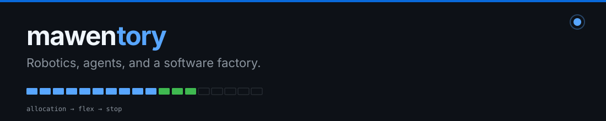

  <picture>
    <source media="(prefers-color-scheme: dark)" srcset="assets/banner-dark.svg">
    
  </picture>

You paid for a model. I tell you which one arrived.

Then I run the shop around it: harness plugins, pooled keys, a quadruped that takes a hand as a command.

### Open first

**[llminspect](https://github.com/mawentory/llminspect)** — which LLM that OpenAI-compatible API is actually serving. Tokenizer meter, one-token JSD, serving-stack DNA. Independent signals. Not three clones of the same scan.

**[dsh-xai-grok](https://github.com/mawentory/dsh-xai-grok)** — SuperGrok / X Premium inside DeepSeek Harness. Device-code OAuth. No API key. No dsh source patch.

**[hermes-plugin-vikunja](https://github.com/mawentory/hermes-plugin-vikunja)** — Hermes talks to a Vikunja instance you run. The token stays on that origin.

### Also on the bench

- [hermes-inline-image-bytes](https://github.com/mawentory/hermes-inline-image-bytes) — rip data-URL image bytes out of Hermes `state.db` only when they are the file on disk
- [api-destroyer](https://github.com/mawentory/api-destroyer) — load-test an OpenAI-compatible router against mock upstreams
- [crwl-docs](https://github.com/mawentory/crwl-docs) — scrape docs so the model can read them offline

### Now

CyberDog. ROS 2 Galactic, Gazebo, LCM, RViz2 on Ubuntu 20.04. `cyberdog_sim` glues Gazebo to ROS 2 and forwards LCM state as topics. `cyberdog_locomotion` is the MIT Cheetah-line walk stack. `basic/` is high-level LCM: motion, sequential, moonwalk gait.

Sim milestone: dog lying in the field. Gazebo up, quadruped on the grid.

Camera → YOLOv5 + MediaPipe. Open palm and two fingers drive the dog. Chairs are obstacles to go around. Orange Pi on the edge (camera + model). GPU box, 8× RTX 2080 Ti over noVNC, for Gazebo and a lap of the track.

### Next

[github.com/mawentory](https://github.com/mawentory)
